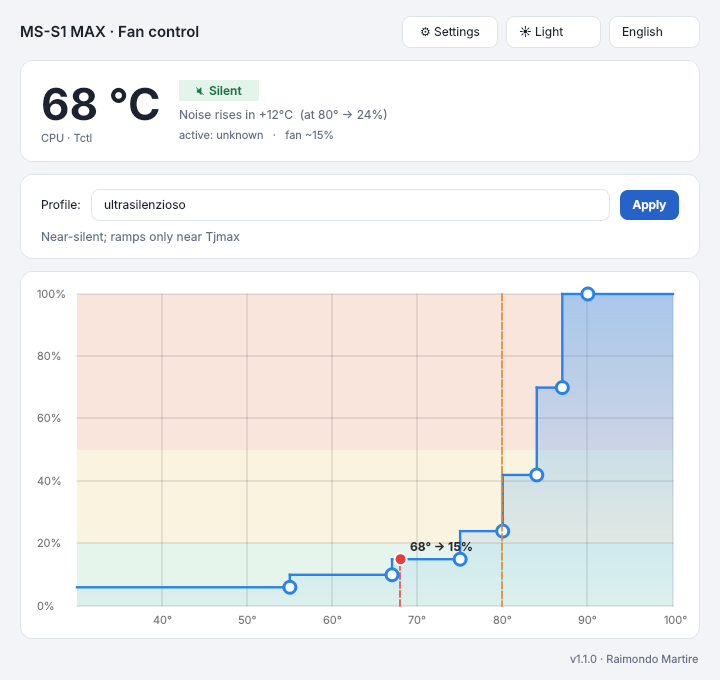
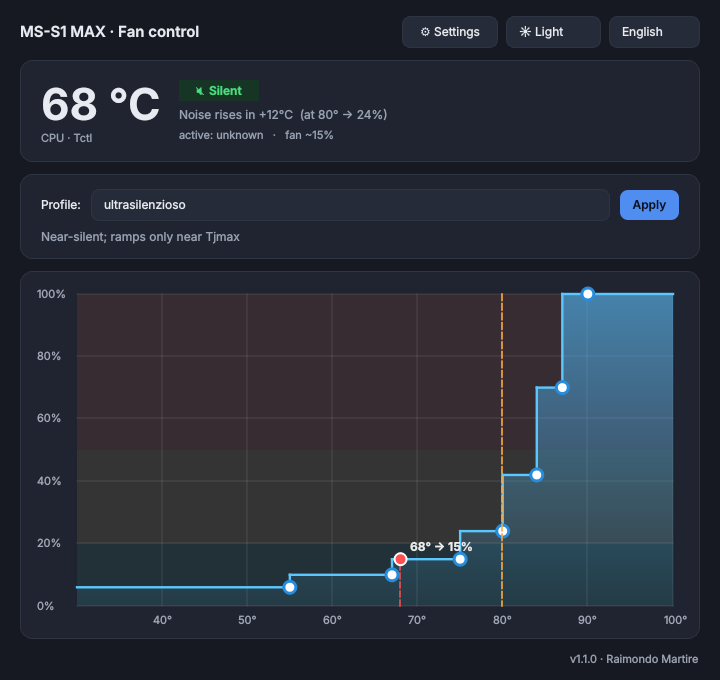

# MS S1 Max fans control

Linux fan control for the **Minisforum MS-S1 MAX** (AMD Ryzen AI Max+ 395,
"Strix Halo"). It replaces the conservative firmware fan curve with a
configurable one, keeping the APU out of thermal throttling under sustained
loads (e.g. local LLM inference) while staying quiet at idle.

It ships a small signed kernel module that exposes the Embedded Controller (EC),
a CLI to apply fan-curve profiles, a PySide6 GUI, and systemd units that make
the chosen profile persist across reboots.

> ⚠️ **Disclaimer.** This project writes directly to the Embedded Controller.
> It has been reverse-engineered specifically on the Minisforum MS-S1 MAX and is
> provided **as-is, without warranty**. Use at your own risk. The fan-curve
> table is validated to be read live by the firmware; a bad value is recoverable
> with a reboot (the firmware restores its stock curve), but you are responsible
> for your hardware.

## Why this exists

- The MS-S1 MAX exposes **no standard Linux fan control** (no hwmon PWM, no fan
  tachometer, no ACPI fan object).
- Its **stock fan curve is very conservative** (only ~40 % duty at 93 °C), so
  under sustained CPU/GPU load the APU reaches Tjmax and throttles.
- On Fedora the usual `ec_sys` debugfs interface is **not available**
  (`CONFIG_ACPI_EC_DEBUGFS` is disabled) and, under **Secure Boot**, kernel
  lockdown blocks debugfs hardware access entirely. This project works around
  all of that.

## How it works

- A minimal signed kernel module (`strixec`) exposes the EC as a character
  device **`/dev/strixec`** (256 bytes, seek + read/write), implemented on top
  of the exported kernel symbols `ec_read()` / `ec_write()`. Unlike the stock
  `ec_sys` debugfs file, a misc char device is **not** blocked by Secure Boot
  lockdown.
- Fan speed is controlled by writing the firmware's **fan-curve table** in EC
  RAM, which the firmware re-reads in real time. Two tables are used, one per
  CPU fan.
- A systemd unit re-applies the chosen curve at every boot (the firmware resets
  to its stock curve on power cycle).

See [`docs/EC-MAP.md`](docs/EC-MAP.md) for the reverse-engineered register map.

## Requirements

- Minisforum MS-S1 MAX (Ryzen AI Max+ 395). Other boards use different EC
  layouts — do **not** assume compatibility.
- Linux with `kernel-devel`/headers for the running kernel, plus `make`/`gcc`.
- Python 3 with **PySide6** for the GUI (`dnf install python3-pyside6`).
- **Secure Boot:** the module is signed with the enrolled *akmods* MOK key if
  present (`/etc/pki/akmods/{private/private_key.priv,certs/public_key.der}`).
  If you don't use akmods, enroll your own MOK and adjust `build-sign-load.sh`.

## Installation

```bash
git clone https://github.com/raimondomartire/ms-s1-max-fans-control.git
cd ms-s1-max-fans-control
sudo ./install.sh
```

The installer builds and signs the module, installs the tools, enables the
systemd units and applies the default profile.

## Usage

### CLI

```bash
sudo strixec-setcurve <profile>     # apply a profile
sudo strixec-setcurve show          # print the current EC curve
```

Profiles:

| Profile           | Character                                             |
|-------------------|-------------------------------------------------------|
| `ultrasilenzioso` | Near-silent in normal use; ramps only near Tjmax      |
| `silenzioso`      | Quiet; firm ramp above ~85 °C                         |
| `leggero`         | Balanced-quiet; 100 % by ~90 °C                        |
| `bilanciato`      | Balanced noise vs temperature                         |
| `aggressivo`      | Maximum cooling (loud) for sustained heavy loads      |
| `stock`           | Restore the factory curve                             |

To make a profile the boot default, edit `ExecStart` in
`/etc/systemd/system/strixec-curve.service`.

Other commands:

```bash
sudo strixec-setcurve custom 55:6,68:10,78:15,84:24,89:42,93:70,97:100  # your own curve, percent
sudo strixec-setcurve set-scale 48  # raw value for full speed (default 100; 48 is under test)
sudo strixec-setcurve test 50 30    # hold 50 % for 30 s, then restore the previous curve
```

### Safety

- Writes are refused unless the DMI product or board name contains `MS-S1`.
  `--force` overrides this. Use it only on a board you have checked yourself.
- A 0 % duty stops the fans. It is refused unless you pass `--allow-off`.
- Record 7 of each fan table is treated as the firmware's protection band:
  its 90–95 °C bounds stay as stock, its value is never lowered, and every
  profile ends at 90 °C or below. See `docs/EC-MAP.md`.
- The table is kept on the EC, so the fans keep the last curve with no daemon
  running. Use `sudo strixec-setcurve stock` to return to the factory curve.

### GUI




Launch **MS S1 Max fans control** from the application menu, or run
`strixec-gui`. The ⚙ Settings menu sets the fan scale and runs a speed test. It shows the live CPU temperature, the selected profile's curve,
and applies profiles with one click (no password needed for users in `wheel`).

## Uninstall

```bash
sudo systemctl disable --now strixec-curve.service strixec.service
sudo rmmod strixec 2>/dev/null || true
sudo rm -f /etc/systemd/system/strixec*.service \
           /etc/polkit-1/rules.d/49-strixec.rules \
           /usr/local/bin/strixec-{setcurve,gui,findfan} \
           /usr/share/applications/strixec-gui.desktop \
           /lib/modules/$(uname -r)/extra/strixec.ko
sudo rm -rf /opt/strixec /usr/local/share/strixec
sudo depmod -a; sudo systemctl daemon-reload
```
A reboot restores the firmware's stock fan curve.

## Credits

- **James** (MS-S1 MAX owner). Found the read/write position bug in the module
  and sent the report. Ran the experiments that settled the table layout (the
  band value is the first byte of an 8-record table at `0x10`), the full-speed
  knee at 48, the rotation-tone measurement (value = RPM/100), and the lowest
  speed of 9. The test plan and data are in his `plan-hwmon.md`.
- **malwareslayer**, author of [minisforum-platform](https://github.com/malwareslayer/minisforum-platform).
  Their driver for the sibling UM790 shows the same value-first layout, reads
  the RPM/100 codes with a tachometer, and never writes the top record, which
  they treat as a firmware protection row. That last point is what our record 7
  rule follows.
- **ibnbajja**, author of the [ec-su_axb35-linux](https://github.com/ibnbajja/ec-su_axb35-linux)
  fork. The board check before writing to the EC and the minimum speed that the
  curve never switches off are their ideas, adapted here.

## Author

Raimondo Martire — <martireraimondo@gmail.com>

## License

GPL-2.0. See [`LICENSE`](LICENSE).
